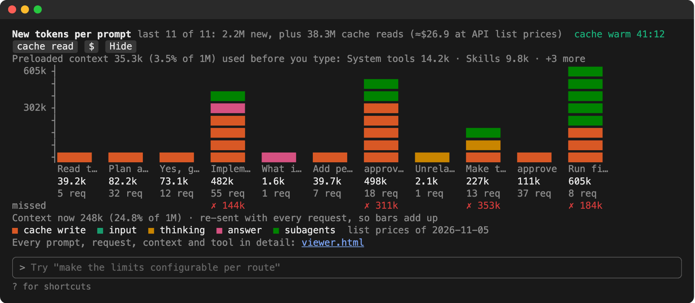
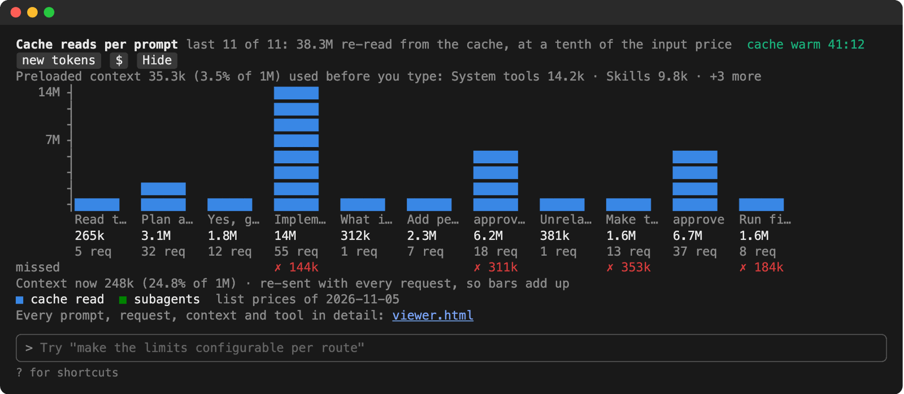
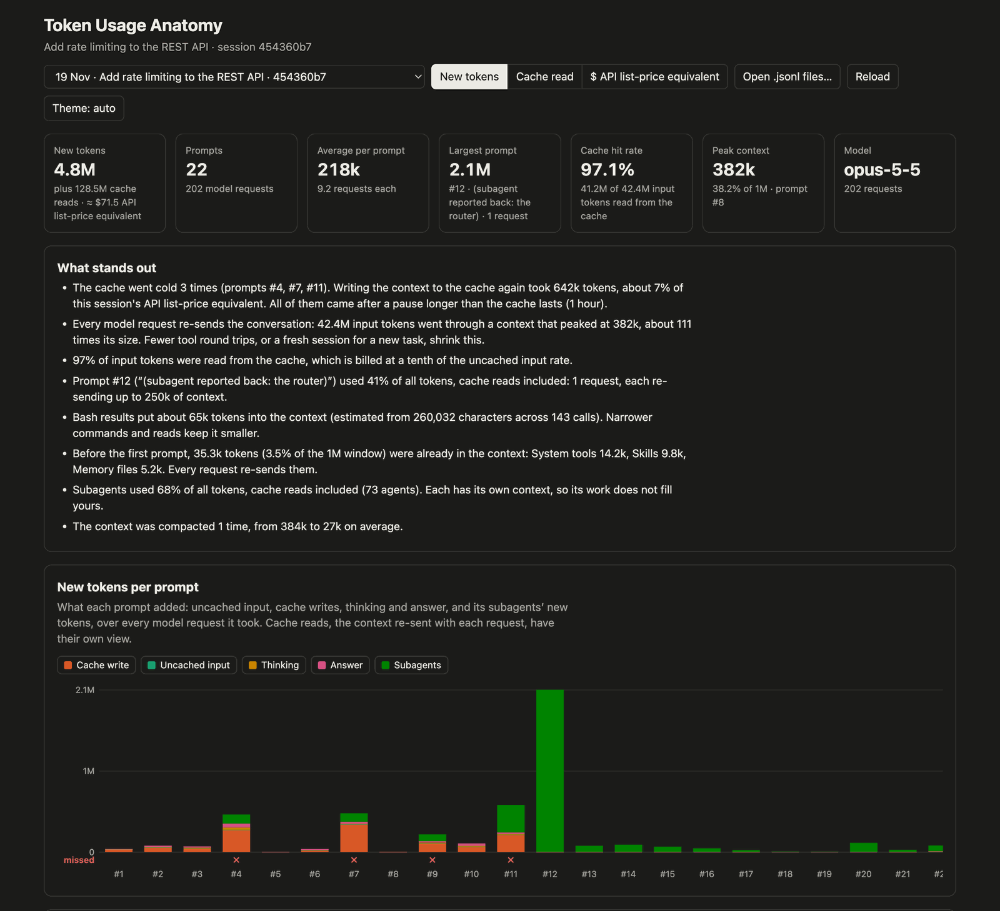
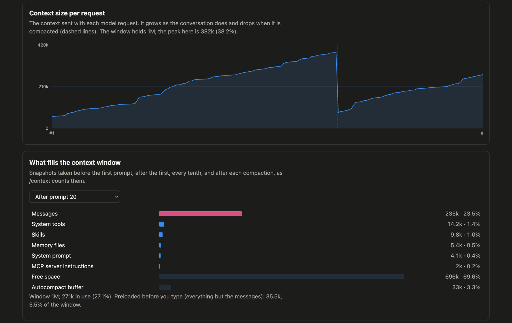

# Token Usage Anatomy

A Claude Code mod that shows how every prompt turns into input, output, cache-read and cache-write tokens, so you can get better results with fewer tokens.

**No network, no telemetry.** The mod never sends anything anywhere. Everything it records stays in a folder on your machine, and the viewer page works offline from disk.



<sub>Screenshots are from a real session; its prompts are replaced with sample text.</sub>

## Why a per-prompt anatomy

Most usage tools give you a total: per day, per session, or a running count in the status line. A total tells you that tokens were spent, not which prompt spent them or why, so it does not change what you type next. This mod takes every prompt apart into what decides its size, and shows it right above the box where you type the next one.

| A total shows | This mod shows | So you can |
| --- | --- | --- |
| One number per day or session | One bar per prompt, labelled with its first words | See which kinds of request are expensive and phrase them differently next time |
| Input and output, added up | New tokens and cache reads apart, each in its own view | Tell a big prompt from a big context. In the session above, 11 prompts added 2.2M new tokens but re-read 38.3M from the cache: the total is mostly the context, re-sent |
| Nothing about requests | The model requests each prompt took | Spot the multiplier. "Implement it across all routes" took 55 requests and re-read its context each time: 14M cache reads. Fewer tool round trips and narrower tool output shrink it |
| Nothing about the cache | A red ✗ with the tokens sent again on each miss, and a countdown until the cache goes cold | Reply while the cache is warm, or start fresh instead of paying to write a large context again after a long break |
| A context percentage | What was loaded before you typed (tools, skills, MCP servers, memory) and what fills the window | Turn off the MCP servers and skills you do not use: every request re-sends them |
| Subagents mixed in, or missing | Subagents as their own part, with their own context | See whether handing work to a subagent kept your context small or just cost more |

**It costs no tokens to run.** The mod reads Claude Code's own transcript after each prompt. Its hooks only watch: nothing is added to the conversation, unlike analysis hooks that inject summaries or reminders, which are re-sent with every later request.

**Better results, not only fewer tokens.** A context full of stale tool output is slower, more expensive and gives the model more to sift through, and when it fills up, compaction drops detail. Seeing the context grow, and what fills it, tells you when to `/compact`, `/clear` or start a new session before the answers suffer.

**Numbers you can check.** Each request is priced on its own and the total is compared with Claude Code's own cost count; any gap is shown, not hidden (see [How the numbers are made](#how-the-numbers-are-made)).

## Install

```sh
claude plugin marketplace add alexzhaobin/hookworks
claude plugin install token-usage-anatomy@hookworks
```

Or in one step from inside Claude Code (2.1.275 or later):

```
/plugin install token-usage-anatomy --marketplace alexzhaobin/hookworks
```

Start a new session afterwards. The chart appears above the prompt once your first prompt is answered. It runs on macOS, Linux and Windows.

## What you get

### The chart above the prompt

In the terminal and the desktop app, a band above the prompt box draws one bar per prompt, in one of three views:

- **New tokens** (the default): what the prompt added, by type: uncached input, cache writes, thinking and answer, plus subagents' new tokens.
- **Cache read**: the context re-read from the prompt cache. Every model request re-sends the whole conversation, so a prompt with ten tool calls reads its context ten times. This is usually most of the count, at a tenth of the input price, so it has a view of its own.
- **$**: the **API list-price equivalent**, what the tokens would cost at Anthropic's published API prices. Most people use Claude Code on a subscription and are not billed per token; the figure is for comparison.

Under each bar is the number of model requests the prompt took, and a red **✗** with the tokens sent again when the prompt cache missed: a request read less than the one before it had cached, after a pause, a compaction or a change at the start of the context. Below the chart are the context window as it stands now and what was loaded before you typed (system prompt, tools, memory, skills). The title line counts down until the prompt cache goes cold.



### The viewer page

`viewer.html` sits in the log folder and opens in any browser, offline. It reads the whole history:



- Totals, then **What stands out**: plain-language findings computed from your rows, such as a cold cache and what writing it again cost, one prompt doing most of the work, or tool results filling the context. A finding appears only when the rows support it.
- New tokens per prompt, the running total, each type on its own scale, the context size at every model request, what fills the context window, tool results, subagents and the cache hit rate, in all three views. A red **✗** under a bar marks a cache miss; hover the bar for what it cost and why (the idle time, or a compaction). Misses are found from each prompt's request list, so logs from earlier versions are marked too.
- Every prompt and every model request in tables, and notes on how each figure was measured or estimated.
- Charts work from the keyboard (one Tab stop each, arrow keys between columns, Escape closes the tooltip) and follow your light or dark theme.

You can also open or drop `.jsonl` logs on the page, from another machine for example.



### `/token-anatomy`

| Command | What it does |
| --- | --- |
| `/token-anatomy` | Shows or hides the chart |
| `/token-anatomy show`, `hide` | Sets it. In VS Code and the mobile apps, which draw no band, `show` opens the chart in a pane |
| `/token-anatomy open` | Prints the link to `viewer.html` for this session |

## Settings

Set these with `/plugin` in Claude Code, or `claude plugin configure token-usage-anatomy@hookworks` in a shell. They take effect in the next session.

| Setting | Default | What it does |
| --- | --- | --- |
| `recordRequests` | off | Also writes one row per model request, subagents' included |
| `includePromptText` | on | Stores the first 2,000 characters of each prompt in its row, so the viewer can label prompts. Off, prompts are shown by number and no prompt text is written anywhere |
| `logDir` | empty | The log folder. Empty means `~/.claude/token-usage-anatomy/` |

## What it reads, writes and runs

**Reads**

- Claude Code's session transcripts under `~/.claude/projects/` (or `CLAUDE_CONFIG_DIR`), including subagents' transcripts and their `.meta.json` files (agent type and description). It takes only each model response's token counts, model and request ID, and the session title. Tool results are measured by size, never stored.
- Claude Code's own figures for the session: its cost count, and the context window by category as `/context` shows it.
- Your theme, for the chart's colours: the `theme` setting, a custom theme's file under `~/.claude/themes/`, and for the `auto` theme the `COLORFGBG` variable, then the system setting (below).
- The environment variables `HOME`, `USERPROFILE`, `OS` and `CLAUDE_CONFIG_DIR`, to find these folders.

**Writes**, only inside the log folder:

| File | Contents |
| --- | --- |
| `<session>.jsonl` | One JSON row per prompt (and per request, if `recordRequests` is on), plus context snapshots, compactions and the session title. A new file, `<session>.2.jsonl`, `.3.jsonl` and so on, starts before one would pass 2 MiB |
| `data/<session>.js` | The same rows for the viewer, which cannot read `.jsonl` files from disk. Text is escaped so no prompt can break the page |
| `usage-index.js` | The list of sessions, newest first |
| `pricing.js` | The price table the rows were priced with |
| `viewer.html` | A copy of `assets/viewer.html`, refreshed when a session starts |

It also keeps session titles in Claude Code's per-plugin store, so the viewer can name sessions.

**Runs**, always with paths passed as arguments, never pasted into a command:

- `scripts/io.sh` with `sh` (macOS, Linux) or `scripts/io.ps1` with PowerShell (Windows), to append rows to the log and to read transcripts larger than 4 MiB.
- For the `auto` theme only: `defaults read -g AppleInterfaceStyle` (macOS), `gsettings get org.gnome.desktop.interface color-scheme` (GNOME) or `reg query HKCU\Software\Microsoft\Windows\CurrentVersion\Themes\Personalize /v AppsUseLightTheme` (Windows).

**Never**: no network requests, no telemetry, nothing written outside the log folder, no tool output or file contents stored. If anything in the mod fails, it notes the error in Claude Code's debug log and the session carries on.

## How the numbers are made

- **Tokens** come from the transcript, request by request, matched to the hooks' own counts. Claude Code writes up to three transcript lines for one streamed request; each request is counted once.
- **Thinking** tokens are the API's own count where it reports one. Where it does not, they are estimated from the share of thinking text, and the viewer marks them "(est.)".
- **Dollars** are priced per request from [`hooks/prices.ts`](hooks/prices.ts), a dated table copied from [Anthropic's pricing page](https://platform.claude.com/docs/en/about-claude/pricing): 5-minute and 1-hour cache writes, long-prompt rates, fast mode and US-only inference included. The band and viewer show the table's date.
- **Unattributed**: after each prompt the mod compares its total with Claude Code's own cost count. A shortfall (from background calls that leave no transcript entry, for example) is drawn as "unattributed"; an excess is noted. Neither is hidden.

## Uninstall

```sh
claude plugin uninstall token-usage-anatomy@hookworks
```

The log folder is yours to keep or delete: `~/.claude/token-usage-anatomy/` unless you set `logDir`.

## Contributing

See [CONTRIBUTING.md](CONTRIBUTING.md) for running the checks, the log format contract and how to propose a change. Changes are listed in [CHANGELOG.md](CHANGELOG.md).

## License

MIT, see [LICENSE](LICENSE).
